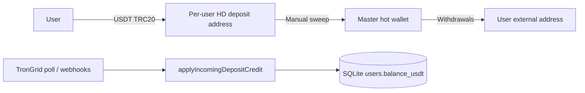

# TRON HD wallet operations runbook

Operational guide for **eisymyanmar** custodial TRON (TRC-20 USDT) wallets: HD deposit addresses, deposit crediting, master wallet withdrawals, sweeps, monitoring, and balance integrity.

---

## Architecture overview



| Component | Path | Role |
|-----------|------|------|
| HD derivation | `backend/src/services/tronHdWalletService.js` | BIP44 `m/44'/195'/0'/0/{index}`; keys never stored |
| Deposit addresses | `backend/src/services/tronDepositAddressService.js` | Persist address + sync Supabase |
| Order + poll | `backend/src/services/tronOrderService.js` | Pending Supabase orders → TronGrid match → credit |
| HD inbound scan | `backend/src/services/hdDepositCreditService.js` | Unsolicited sends to HD addresses |
| Wallet credit | `backend/src/services/depositCreditService.js` | Atomic `claimForCredit` + balance + ledger |
| Master wallet | `backend/src/services/tronMasterWalletService.js` | Withdrawals + gas for sweeps |
| Sweep | `backend/src/services/tronSweepService.js` | TRX gas → USDT to master (**manual only**) |
| Monitor | `backend/src/services/tronWalletMonitorService.js` | Telegram alerts (TRX low, sweep failures) |

**Important:** User `balance_usdt` is updated when a deposit is **verified in the database**, not when USDT is swept to master. On-chain USDT may sit on HD addresses until ops run a sweep.

---

## Environment variables

### HD seed (choose one)

| Variable | Description |
|----------|-------------|
| `TRON_HD_MNEMONIC` | Preferred BIP39 mnemonic |
| `TRON_HD_SEED_HEX` | Hex seed (≥16 bytes) |
| `MASTER_PRIVATE_KEY` | Fallback seed material for HD (also signs master transfers) |
| `TRON_HD_ENABLED` | `true` (default) / `false` |
| `TRON_HD_INDEX_OFFSET` | Added to `userId` for derivation index |

### Master wallet

| Variable | Description |
|----------|-------------|
| `MASTER_PRIVATE_KEY` | **Required** for withdrawals and sweep gas |
| `MASTER_WALLET_ADDRESS` | Optional; must match key-derived address if set |
| `MASTER_TRX_LOW_THRESHOLD` | Alert when TRX below this (default **30**) |
| `USDT_TRC20_CONTRACT` | Default mainnet USDT |

### TronGrid

| Variable | Description |
|----------|-------------|
| `TRON_FULL_HOST` / `TRONGRID_FULL_HOST` | API host |
| `TRONGRID_API_KEY` / `TRON_PRO_API_KEY` | Pro API key (recommended) |

### Deposits

| Variable | Description |
|----------|-------------|
| `DEPOSIT_LISTENER_SECRET` | Auth for deposit listener / some cron paths |
| `CRON_SECRET` | Bearer token for `/api/cron/*` |
| `TRON_ORDER_POLL_ENABLED` | In-process poller on long-running servers |
| `TRON_HD_SCAN_ON_READ` | Scan user HD address when wallet UI loads |
| `TRON_HD_SCAN_BATCH_SIZE` | Addresses per batch in cron HD scan (default **200**) |
| `TRON_HD_SCAN_MAX_ADDRESSES` | Max addresses per cron pass (default **5000**) |

### Sweep (manual)

| Variable | Default | Description |
|----------|---------|-------------|
| `TRON_SWEEP_GAS_TRX` | 1.1 | TRX sent from master → deposit for each sweep |
| `TRON_SWEEP_GAS_WAIT_MS` | 3000 | Wait after gas tx before USDT transfer |
| `TRON_SWEEP_MIN_USDT` | 25 | Skip sweep if deposit USDT below this |
| `TRON_SWEEP_SKIP_GAS_IF_TRX` | ~0.55 TRX | Skip gas if deposit already has TRX |

### Monitoring (Telegram admin chat)

| Variable | Default | Description |
|----------|---------|-------------|
| `TRON_WALLET_MONITOR_ENABLED` | on (off in `NODE_ENV=test`) | Master TRX + sweep alerts |
| `TRON_MONITOR_ALERT_COOLDOWN_MINUTES` | 60 | Throttle repeat alerts |
| `TELEGRAM_BOT_TOKEN` / admin chat id | — | Required for alerts (see `telegram.js`) |

---

## Deposit crediting (balance accuracy)

All USDT top-ups converge on:

1. `applyIncomingDepositCredit()` — resolve user/deposit, verify tx when required  
2. `creditDepositAndVerify()` — purpose-specific path  
3. `creditUsdtBalanceAtomic()` — **single transaction**: `claimForCredit` → `users.balance_usdt` += net → `usdt_wallet_transactions`

**Double-credit protection**

- DB unique indexes on `tx_hash` / `txn_id`  
- `assertTxHashAvailable()` before attach  
- `claimForCredit()` only succeeds once per deposit row  

**Detection paths**

1. **TRON order poll** — pending Supabase order amount matches inbound transfer to that order’s HD address (FIFO by order `created_at` when multiple pending).  
2. **HD inbound cron scan** — paginated scan of all custodial addresses (not only the last 100 updated).  
3. **Webhooks** — `/api/webhook/tron` with on-chain verification.  
4. **Read scan** — best-effort when user opens wallet/deposit UI (`TRON_HD_SCAN_ON_READ`).

Regression scripts:

```bash
node backend/scripts/test-deposit-security.js
node backend/scripts/test-deposit-wallet-credit.js
node backend/scripts/test-tron-auto-deposit-withdraw.js
node backend/scripts/test-tron-orders.js
```

---

## Sweep procedure (collect USDT to master)

Sweeps are **never scheduled automatically**. Use admin API or CLI after deposits accumulate on HD addresses.

### Preconditions

- Master wallet holds enough **TRX** for gas (`TRON_SWEEP_GAS_TRX` × number of addresses swept).  
- Master **USDT** is not required for sweep (USDT moves deposit → master).  
- `MASTER_WALLET_TRANSFERS_PAUSED` must be `false` for live sweeps.

### Admin API

```http
POST /api/admin/sweep-deposits
Authorization: admin session (permission: master_wallet)

{ "dry_run": true }
{ "user_id": 42 }
{ "force_gas": true, "limit": 500 }
```

`GET /api/admin/sweep-deposits` — list sweepable custodial addresses (no chain txs).

### CLI

```bash
cd backend
npm run sweep:tron-deposits -- --dry-run --all
npm run sweep:tron-deposits -- --user-id=42
npm run sweep:tron-deposits -- --all
```

### Flow per address

1. Read USDT balance on HD address; skip if &lt; `TRON_SWEEP_MIN_USDT`.  
2. If deposit TRX &lt; threshold → master sends `TRON_SWEEP_GAS_TRX` TRX.  
3. Deposit address signs USDT `transfer` → master address.  

Failures (insufficient master TRX, transfer errors) trigger **Telegram alerts** when monitoring is enabled.

---

## Monitoring and alerts

Service: `backend/src/services/tronWalletMonitorService.js`

| Alert | When |
|-------|------|
| `master_trx_low` | Master TRX &lt; `MASTER_TRX_LOW_THRESHOLD` |
| `master_address_mismatch` | `MASTER_WALLET_ADDRESS` ≠ address from private key |
| `master_balance_unreachable` | TronGrid/Tronscan/TronWeb all fail |
| `sweep_failures` | Manual sweep finished with `failed` &gt; 0 |
| `sweep_insufficient_trx` | Sweep failed for lack of master TRX |

**When alerts run**

- After each **`runTronOrderPollSafely()`** (Vercel cron `GET/POST /api/cron/tron-deposits`).  
- After **`runManualSweep()`** completes (or throws on catastrophic error).

Admin UI: **Overview → Master wallet** shows TRX/USDT and low-TRX styling (`GET /api/admin/master-wallet-balance`).

Test:

```bash
node backend/scripts/test-tron-wallet-monitor.js
```

---

## Cron (production)

Root `vercel.json` schedules:

```json
{ "path": "/api/cron/tron-deposits", "schedule": "15 3 * * *" }
```

That hit runs order verification, full HD deposit scan (batched), and wallet monitor. For faster crediting on high volume, increase frequency (e.g. every 15 minutes) in Vercel Cron and ensure `CRON_SECRET` is set.

Auth: `Authorization: Bearer $CRON_SECRET` or Vercel `x-vercel-cron: 1`.

---

## Health checks

- `GET /api/health/tron` — master address consistency, TronGrid reachability, master balances (used for deploy smoke tests).

---

## Supabase

Apply `supabase/user_tron_hd_addresses.sql` (or legacy `user_tron_deposit_addresses`).  
HD sync uses adaptive upsert if columns are missing.

---

## Incident checklist

| Symptom | Action |
|---------|--------|
| Users paid but balance unchanged | Check pending order in Supabase; run cron or `sync-deposits`; verify TronGrid key; check tx not below min deposit |
| Sweep stuck / failed | Fund master TRX; check Telegram alert; retry with `force_gas`; inspect `SWEEP_*` codes in logs |
| Withdrawals fail | Master USDT + TRX; `MASTER_WALLET_TRANSFERS_PAUSED`; address mismatch |
| Duplicate credit concern | Query `deposit_requests_v2` for tx_hash; verify single VERIFIED row; ledger `usdt_wallet_transactions` |

---

## Security notes

- Never log or persist HD private keys or mnemonics.  
- `BYPASS_USDT_TX_VERIFICATION` is refused in production.  
- Rotate `MASTER_PRIVATE_KEY` after any leak; set pause flags until rotation completes.  
- Sweeps and withdrawals share the master key — restrict admin `master_wallet` permission.

---

## Related HTTP routes

| Route | Notes |
|-------|--------|
| `/api/tron/orders` | Create/list TRON deposit orders |
| `/api/cron/tron-deposits` | Scheduled deposit + monitor pass |
| `/api/admin/sweep-deposits` | Manual sweep |
| `/api/admin/master-wallet-balance` | Ops dashboard balances |
| `/api/webhook/tron` | Tron-style deposit webhooks |

Legacy façade (still documented in code): `backend/src/services/tronWalletService.js`, `/api/tron/wallet/*`.
